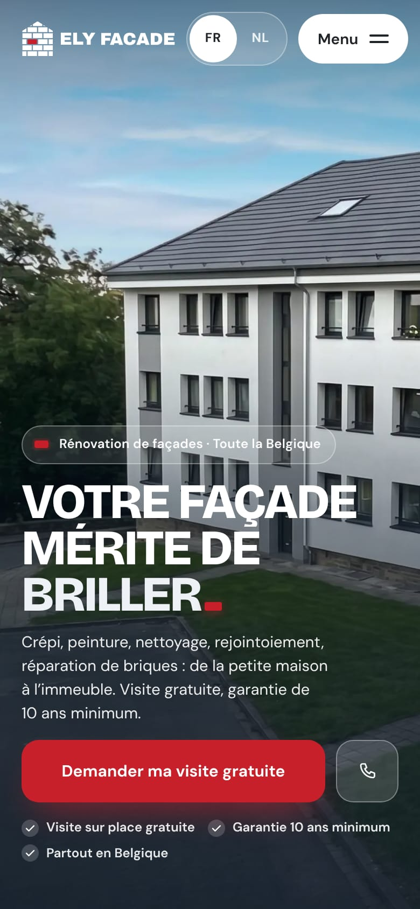
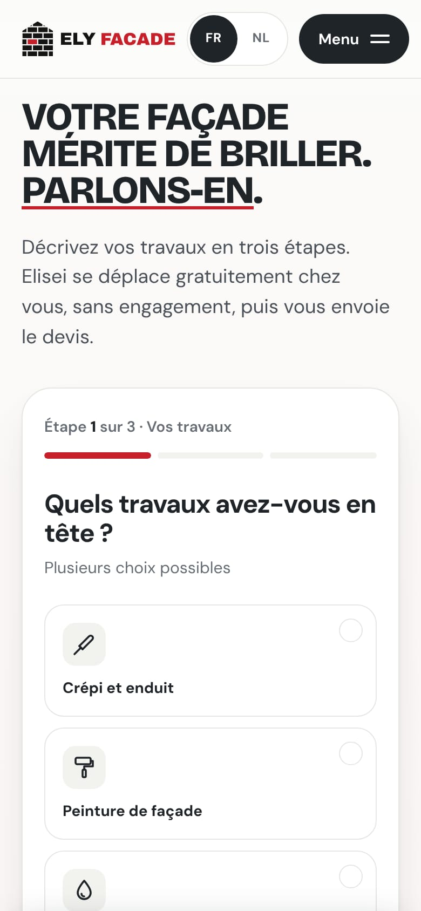
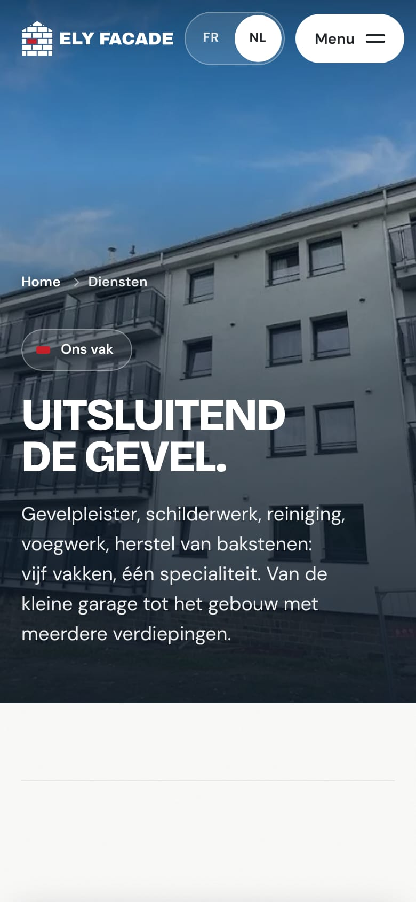
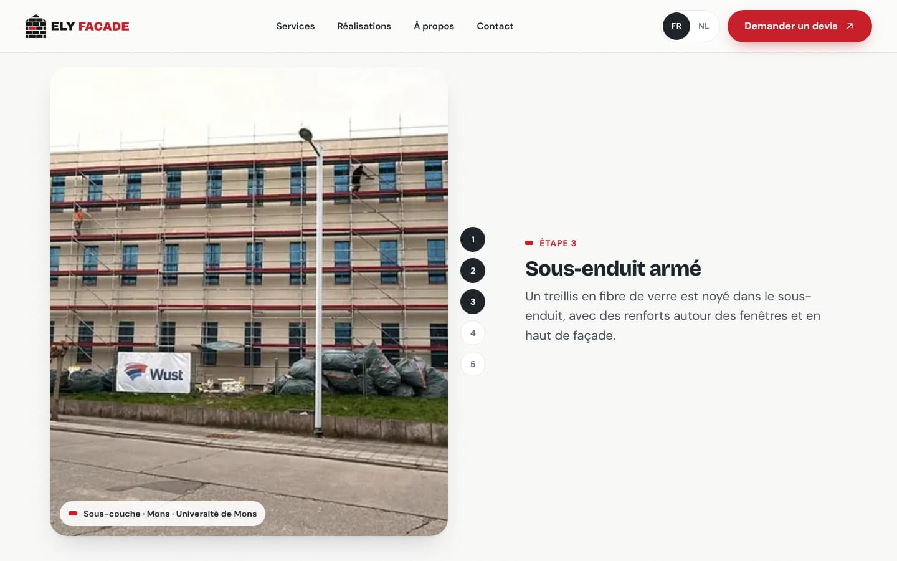
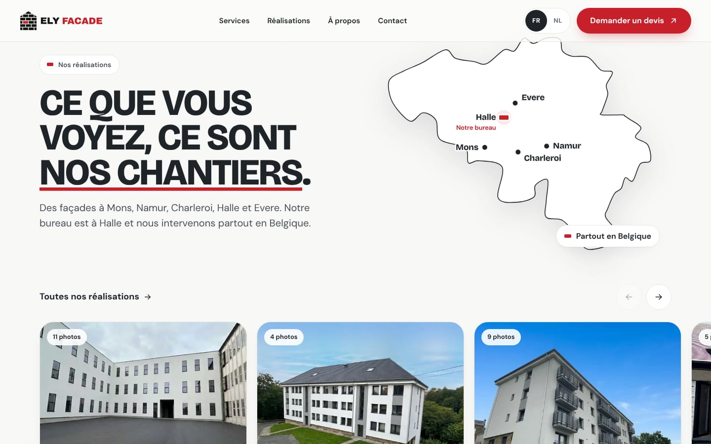
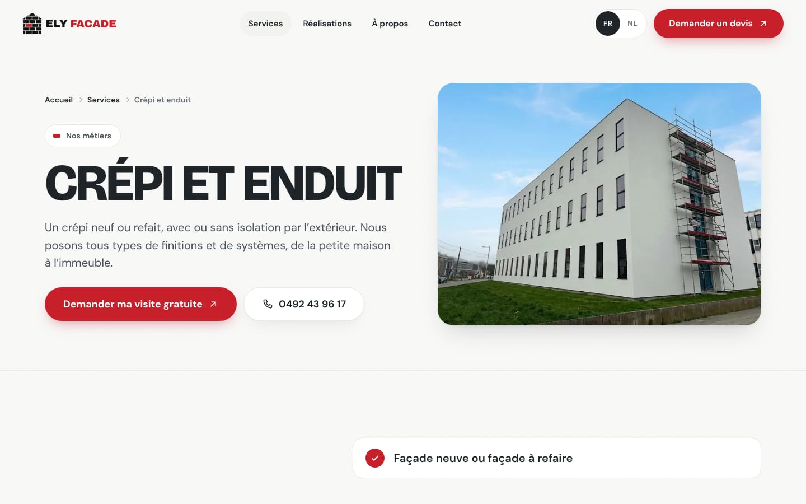
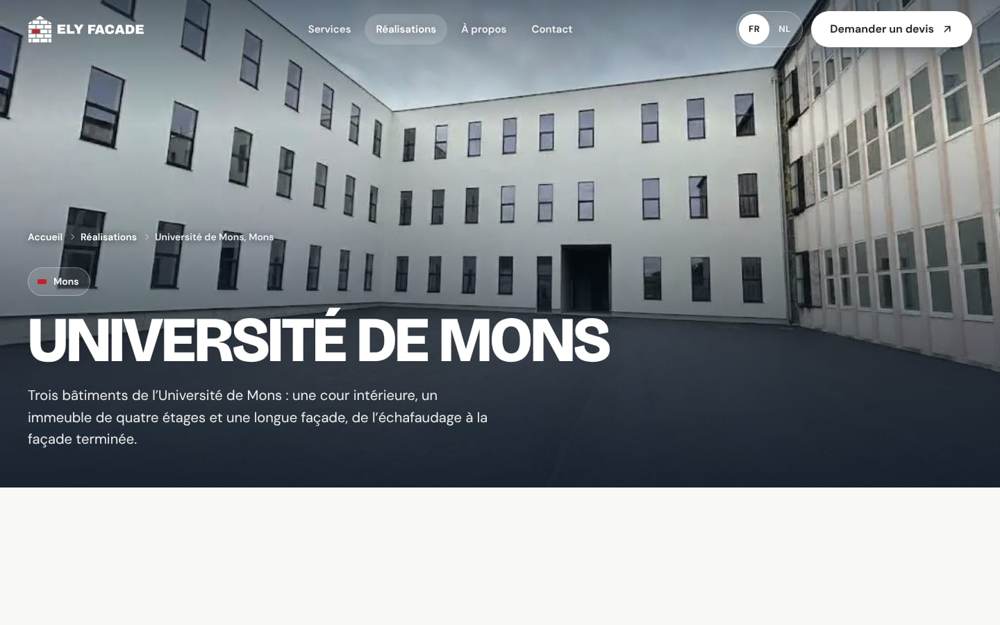

# Ely Facade

Le site d'**Ely Facade**, entreprise de rénovation de façades. Bureau à Halle, chantiers partout en Belgique. En français et en néerlandais.

Adresse prévue : **elyfacade.be**

## Ce que le site offre

- **Les vrais chantiers, en photos.** Avant / après à faire glisser (Université de Mons, Namur, Halle, Charleroi), et une page par chantier avec toutes ses photos en grand. Seule la commune est indiquée, jamais l'adresse d'un client.
- **Les étapes d'une façade, racontées au défilement** : de l'échafaudage à la façade terminée, sur le chantier de l'Université de Mons.
- **Cinq métiers, uniquement la façade** : crépi et enduit, peinture, nettoyage, rejointoiement, réparation de briques. Une page pour chacun.
- **Une demande de devis simple** : un formulaire en trois étapes, un calculateur qui estime la surface de façade, l'envoi de photos par WhatsApp, l'appel en un geste. Sur téléphone, les boutons Appeler, WhatsApp et Devis restent toujours à portée de pouce.
- **Les deux langues** : chaque page existe en français et en néerlandais, et le site s'ouvre dans la langue du téléphone.

| Sur téléphone | Le devis | En néerlandais |
| --- | --- | --- |
|  |  |  |

| Avant / après | Les étapes d'une façade |
| --- | --- |
|  |  |

| Nos réalisations | Un métier | Un chantier |
| --- | --- | --- |
|  |  |  |

## Le design

- **Clair, comme une façade terminée.** Fond blanc chaud, texte gris ardoise, et le rouge du logo en petites touches.
- **La brique rouge comme signature** : elle vient du logo et revient partout (points, puces, soulignements, point final du titre).
- **« La façade qui brille »** : en haut de l'accueil, un reflet de lumière passe une fois sur les murs blancs de l'immeuble, puis sur le mot « briller ».
- **Des titres en capitales**, serrés et affirmés (Bricolage Grotesque), et un texte courant très lisible (DM Sans).
- **Des animations discrètes** qui se coupent quand le téléphone ou l'ordinateur demande moins d'animations.
- **Pour tout le monde** : contrastes suffisants, navigation au clavier, tout reste lisible sans JavaScript, du petit téléphone au grand écran.
- **Respect de la vie privée** : aucun cookie, aucune mesure d'audience, polices hébergées sur le site.

## Crédits

- Photos : les chantiers d'Ely Facade.
- Logo, site et illustrations : Claudiu.
- Polices : [DM Sans](https://fonts.google.com/specimen/DM+Sans) et [Bricolage Grotesque](https://fonts.google.com/specimen/Bricolage+Grotesque), licence SIL Open Font License, hébergées sur le site.
- Construit avec [Astro](https://astro.build), défilement doux par [Lenis](https://lenis.darkroom.engineering), hébergé par [Netlify](https://www.netlify.com).

© Ely Facade
