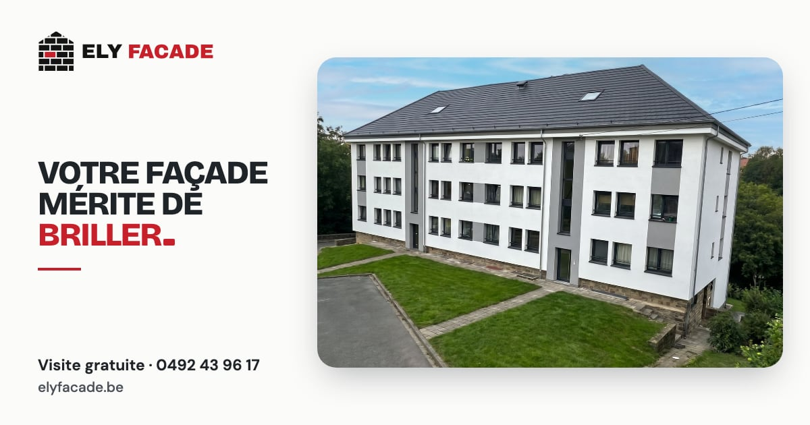
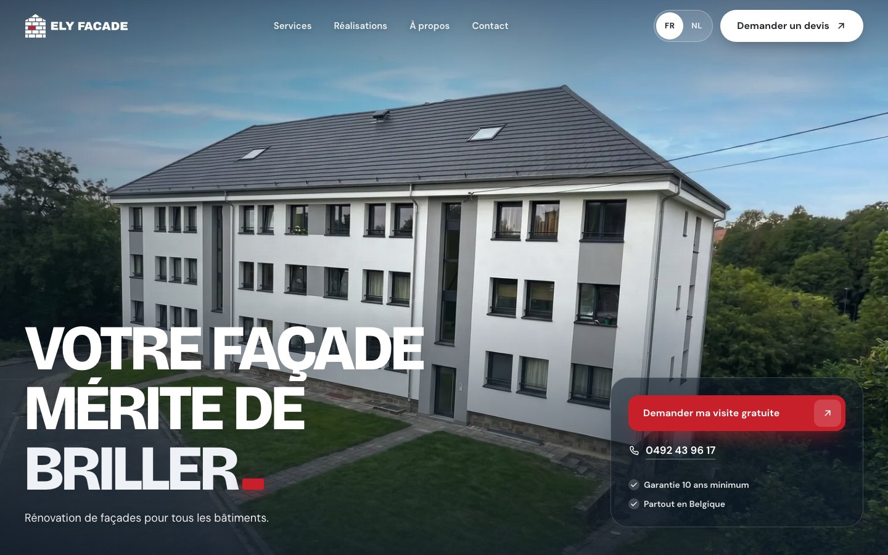
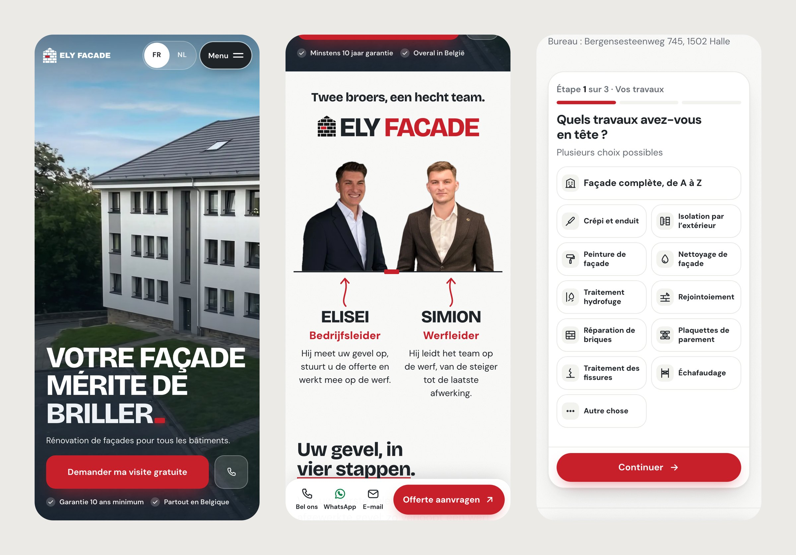
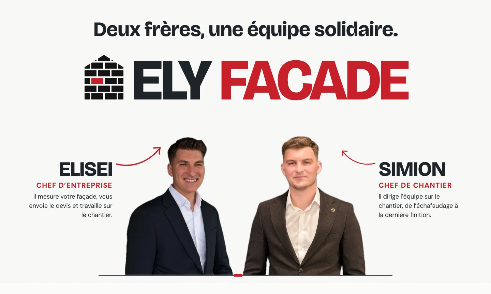
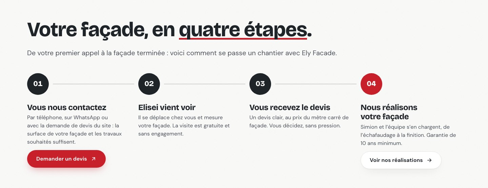
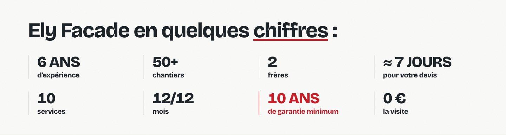
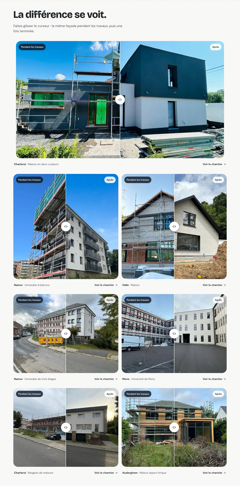
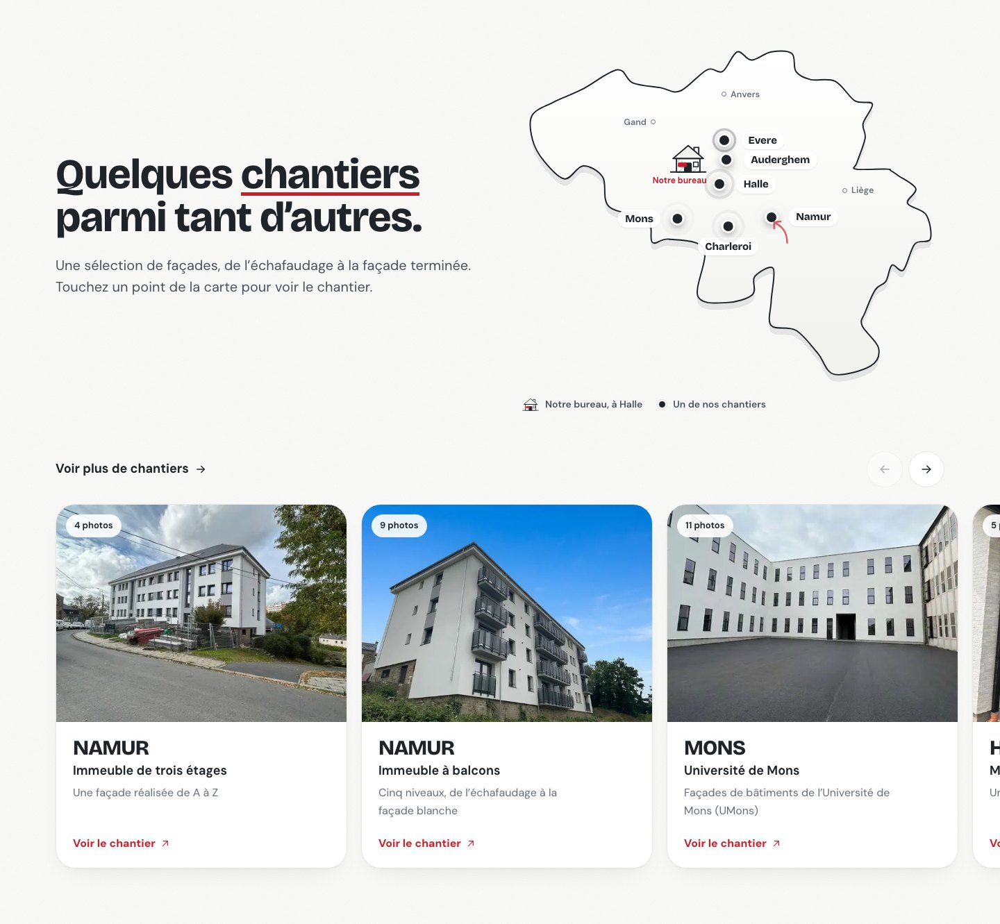
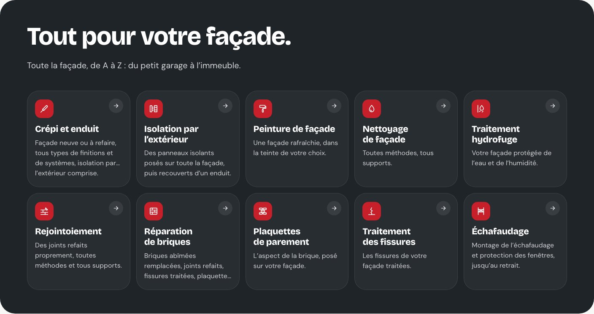

# Ely Facade

**Le site d'Ely Facade, entreprise de rénovation de façades. Bureau à Halle, chantiers dans toute la Belgique.**

[elyfacade.be](https://elyfacade.be) · Français & Nederlands

---

## L'idée

Un propriétaire, un syndic ou une société qui cherche quelqu'un pour sa façade veut surtout savoir **qui va venir** et **voir ce qu'ils ont déjà fait**. Le site est construit autour de ça : deux frères en photo, de vrais chantiers avant et après, une façon de travailler expliquée simplement, et une demande de visite gratuite en une minute, depuis son téléphone.

---

## Ce qu'on y trouve

**✨ La façade qui brille**
En haut de l'accueil, une façade blanche refaite à Namur. Un reflet de lumière passe une fois sur ses seuls murs blancs, puis sur le mot « briller », et la brique rouge du logo vient se poser comme point final du titre.

**👥 Deux frères, une équipe solidaire**
Juste sous le haut de page, Elisei et Simion, détourés devant « ELY FACADE » écrit en très grand. Chacun a son repère, comme une annotation sur un plan : son prénom, son titre et une phrase sur ce qu'il fait sur votre chantier.

**🪜 Une façade en quatre étapes**
Du premier appel à la façade terminée, quatre étapes claires, avec un bouton de devis au début et les réalisations à la fin. Plus bas, un vrai chantier de l'Université de Mons raconte au défilement le travail d'une façade : échafaudage, isolation, sous-enduit armé, finition.

**↔️ De vrais avant/après**
De vrais chantiers (Namur, Halle, Mons, Charleroi, Auderghem) : on fait glisser la poignée pour passer de « Pendant les travaux » à « Après », au doigt, à la souris ou au clavier. Sur téléphone, la page continue de défiler normalement.

**🗺️ La carte des chantiers**
Une carte de Belgique dessinée pour le site : le bureau de Halle et les communes des chantiers. Un point touché ouvre son avant/après et le lien vers le chantier. Chaque chantier a sa page, avec toutes ses photos en grand. Seule la commune est indiquée, jamais l'adresse.

**🧱 10 services, toute la façade de A à Z**
Crépi et enduit, isolation par l'extérieur, peinture de façade, nettoyage de façade, traitement hydrofuge, rejointoiement, réparation de briques, plaquettes de parement, traitement des fissures, échafaudage. Chacun a **sa propre page** : ce qui est fait, les étapes, des photos ou une illustration, et un devis où il est déjà coché.

**📝 Un devis en trois étapes**
1. Les travaux envisagés, à cocher.
2. Le bâtiment et la surface, avec un **simulateur** : largeur et nombre de niveaux, et la surface se calcule toute seule.
3. Les coordonnées.

À la dernière étape, le visiteur peut **joindre jusqu'à cinq photos** de sa façade : elles sont réduites sur son téléphone avant l'envoi, et sa demande arrive par email avec les photos en pièces jointes. Il peut aussi prolonger la conversation par **WhatsApp**, avec sa demande déjà écrite.

**📍 Joignable en un geste**
La page Contact met le téléphone, WhatsApp, l'email et l'**itinéraire Google Maps** vers le bureau de Halle à un clic. Rien n'est chargé depuis Google tant qu'on ne clique pas : un simple lien, donc toujours aucun cookie.

**📱 Pensé d'abord pour le téléphone**
Une barre toujours à portée de pouce (Appeler · WhatsApp · Email · Devis), un menu plein écran et le choix FR/NL en haut de l'écran.

**🇧🇪 En français et en néerlandais**
Toutes les pages et tous les textes existent dans les deux langues. Le site s'ouvre dans la langue de l'appareil, et le choix du visiteur est retenu.

### Les pages

| | Français | Nederlands |
|---|---|---|
| Accueil | Accueil | Startpagina |
| Les services | Services | Diensten |
| Un service (×10) | Services › Crépi et enduit… | Diensten › Gevelpleister… |
| Les chantiers | Réalisations | Realisaties |
| L'entreprise | À propos | Over ons |
| Le devis | Contact | Contact |
| Légal | Mentions légales · Vie privée | Juridische informatie · Privacy |

---

## Rapide, accessible, respectueux

**Rapide.** Un site statique, sans base de données. Les photos sont servies en WebP à la bonne taille pour chaque écran et ne se chargent qu'au moment où on s'en approche.

**Facile à trouver.** Chaque page a son propre titre et sa propre description, chaque service a sa page en français et en néerlandais, et les moteurs de recherche reçoivent une fiche claire de l'entreprise, de ses services et de chaque page.

**Accessible.** Contrastes suffisants, navigation complète au clavier, texte alternatif sur chaque photo, curseurs avant/après utilisables sans souris. Tout reste lisible sans JavaScript, et les animations s'arrêtent pour ceux qui ont demandé à en voir moins.

**Respectueux.** Aucun cookie, aucun outil de suivi, aucune publicité, polices hébergées sur le site. Les photos de chantier ne contiennent aucune information de localisation, et seule la commune d'un chantier est indiquée, jamais l'adresse.

---

## Design

**Clair, comme une façade terminée** : un blanc chaud, l'ardoise des toitures et le rouge de la brique du logo, en petites touches.

| | Couleur | Rôle |
|---|---|---|
|  | Blanc façade `#FBFBFA` | Le fond, clair et calme |
|  | Ardoise `#1F2429` | Titres, boutons, sections sombres |
|  | Rouge brique `#C8202B` | La brique du logo, les mots soulignés, le bouton de devis |
|  | Gris `#4A5058` | Le texte courant |

**La brique rouge comme signature** : elle vient du logo et revient partout, en point final des titres, en soulignement qui se trace sous les mots clés, en repère sur la carte.

**Polices :** Bricolage Grotesque pour les titres, DM Sans pour le texte.

---

## Crédits

Logo, site et illustrations conçus et développés par **Claudiu Popadiuc**
[claudiu.dev@outlook.com](mailto:claudiu.dev@outlook.com?subject=Un%20site%20comme%20celui%20d%27Ely%20Facade)

*Un site comme celui-ci pour votre entreprise ? Écrivez-moi.*

© Ely Facade : les photos, les portraits, le logo et les textes appartiennent à Ely Facade et ne peuvent pas être réutilisés sans son accord. Le code est visible à titre de référence.

Photos : les chantiers d'Ely Facade · Construit avec [Astro](https://astro.build) · Hébergé par [Cloudflare](https://www.cloudflare.com)

